# 64 — R.A.B.B.I.T. SCENES: the frame count's chevrons no longer cover the figure

**What you asked for (2026-10-11).** *"for the frame count bar in the shot
items, see image, the chevrons are covering up the numbers. lets please make
sure this can be seen correctly with spacing between each. after 5 digits,
add ellipsis to keep."*

Written 2026-10-12 against `feat/post-overhaul-edit-versioning` (FX1,
`po/fx1-shot-frame-count`). No database change, nothing to deploy. This is
display only: every number you type is saved exactly as before.

## What was wrong

The frame count field in the shot rows was 64 pixels wide, and the browser's
own up and down arrows took 15 of them. That left room for four digits and
no gap at all. So **2000** ran straight into the arrows when you pointed at
it, and a longer count was cut off at them: **12345** and **123456** both
read **1234**.

## What you will see

1. **Scenes tab, a scene's shots** (the arrow at the left of a scene row).
   Each shot's **Frames** field is a little wider and holds five digits with
   room to spare. Point at it and its own up and down arrows appear at its
   right edge, with a clear gap between them and the last digit.
2. **Five digits or fewer show whole**, from **0** up to **99999**.
3. **Six digits or more show the first five and an ellipsis**: **123456**
   reads **12345…**. Point at the field and the whole number is in its
   tooltip. Click into it and the whole number comes back, ready to type
   into. Click away and the ellipsis returns.
4. **The arrows** add or take away one frame per click and stop at zero.
   Hold one down and it keeps counting until you let go, as the browser's
   arrows did.

In the tables the field shows up to six digits whole while you are in it.
A number of seven digits or more scrolls inside the field, like any long
text, and the tooltip still has the whole number. A shot that long would
run for more than eleven hours at 24 frames a second.

**The keyboard's up and down arrow keys do not change the number.** They
never did, before this fix either: a keyboard shortcut meant for the Home
page catches them on every page. Worse, pressing **Enter** after one of them
opens a Home page item (Settings, or D.O.G.). That is a known problem,
listed in `docs/OUTSTANDING.md` (P1-03), and it is not part of this fix. To
change a number, type it or use the field's own arrows.

The same field is now in five other places:

- the **Shots** view's Frames column;
- an **edit's cut** (an edit on screen, its Frames column);
- the **shot's details** window: **Frame count** and **Shot number**;
- the **scene's details** window: **Scene number**.

In the two details windows the fields are wide, so nothing was ever cut off
there. They follow the same rule anyway: five digits, then an ellipsis.

Unchanged: what gets saved, every column's width, the table's other fields.
A reviewer sees the same figures and no arrows, because a reviewer cannot
change shots.

## Things to try

1. Open any project with scenes, **Scenes**, open a scene's shots and type
   **2000** into a shot's Frames. Point at the field: the arrows sit to the
   right of **2000** with a gap between. On a window narrower than about 1440
   pixels a scene's shots run past the window's right edge, as they did
   before: scroll the table sideways to reach the Frames column.
2. Type **123456**, then click somewhere else. The field reads **12345…**.
   Point at it: the tooltip says **123456**. Click into it: **123456** again.
3. Click the up arrow once. The field reads **123457** while you are in it,
   and the shot's duration beside it goes up by one frame. Hold the arrow
   down: it keeps counting until you let go.
4. Open the shot's details (the eye) and look at **Frame count**: the same
   **12345…** until you click into it.

## Before and after

The pictures are in `docs/sessions/handoffs/img/`. Each pair is the same
moment before the fix and after it. The close-ups show the Frames column at
twice the size.

Your picture: three shots at **2000**, **6000** and **0**, the pointer on the
first.

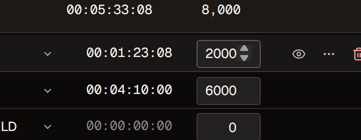
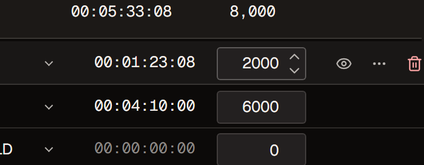

Five and six digits, **12345** and **123456**, at rest. Before, both read
**1234**.

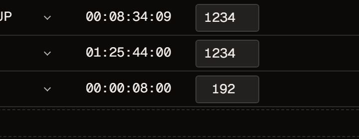
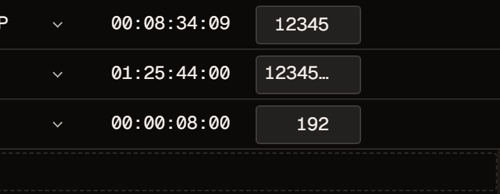

**123456** with the cursor in the field.

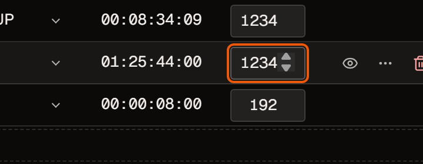
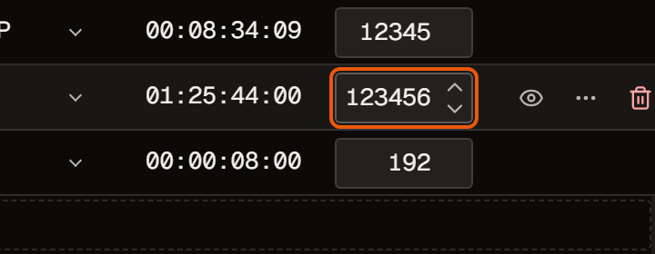

The whole page at 1440x900, a 14-inch laptop:

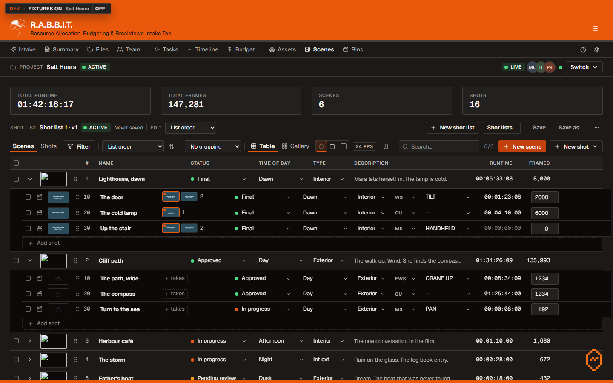
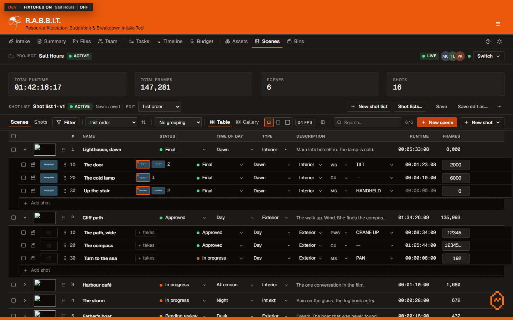

1280x700, a smaller laptop window. At this size a scene's shots run past the
window's right edge, as they did before (they are laid out to fit 1440), so
these two were taken with the shots scrolled sideways to the Frames column:

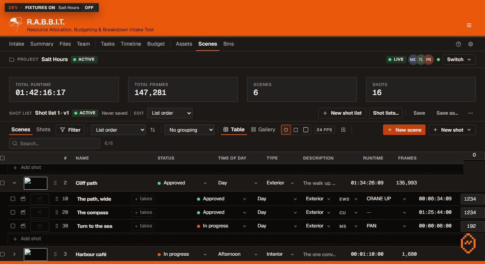

The Shots view, the shot's details, the scene's details and an edit's cut,
after, at 1440x900:

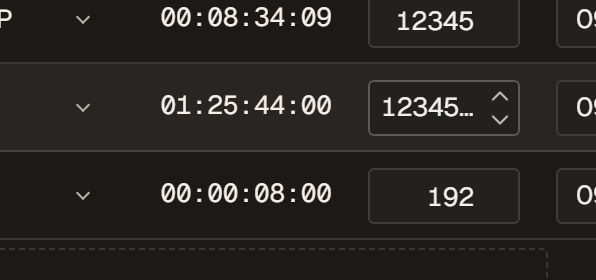
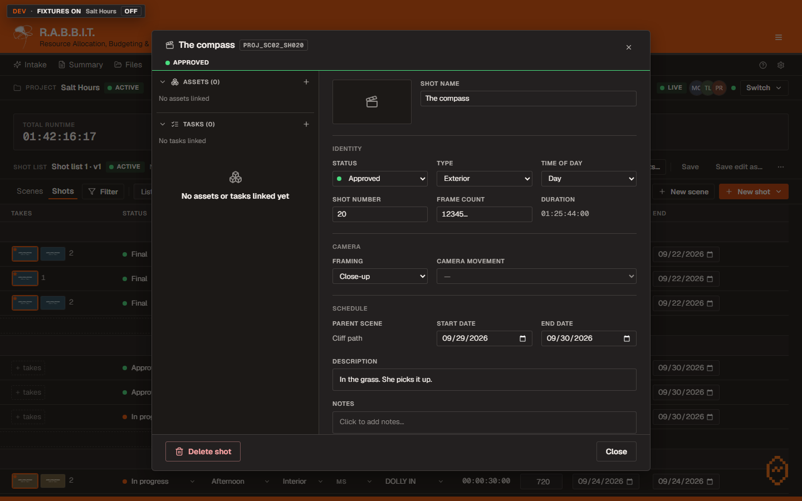
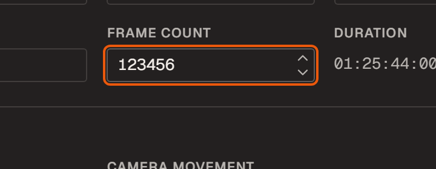
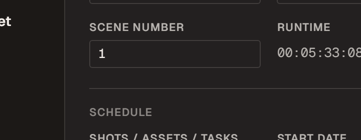
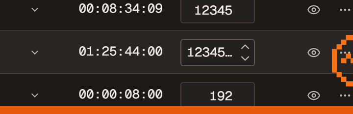

Every state at both sizes, before and after, is in the same folder:
`po-fx1-before-*` and `po-fx1-after-*`.

**How these were taken.** A test browser opened a developer's copy of the
app filled with made-up data: a pretend project called Salt Hours, which your
app does not have. It typed the numbers into the fields, photographed each
state and measured every field. The made-up data lives only in that test
browser's memory, so nothing was saved anywhere.

## One more field with the same problem, not fixed here

The **Tasks** table's **Bid days** field has the browser's arrows too, and
room for three characters beside them. A bid of **12.5** days reads **2.5**
while you are in the field. That table belongs to another part of the plan,
so it is listed in `docs/OUTSTANDING.md` rather than changed here.
